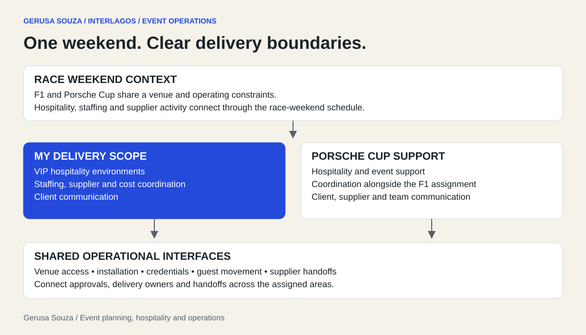
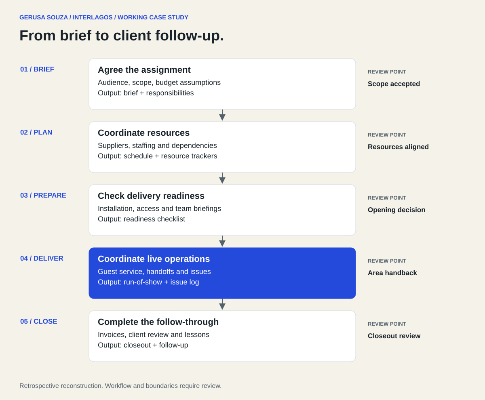

# Interlagos: VIP Hospitality & Event Operations

Gerusa Souza · São Paulo, Brazil · Working case study

A visual walkthrough of my reported VIP hospitality, supplier coordination, staffing and client-management work around the Formula 1 race weekend, with related Porsche Cup support.

This is a retrospective reconstruction based on my supplied portfolio. Proposed workflows explain the delivery method for review. They are not original event records.

## Start here

- [Visual case-study page](index.html): download and open locally, or view after site deployment.
- [Delivery roadmap](#02--delivery-roadmap)
- [Supporting deliverables](#working-deliverables)
- [Evidence and review checklist](evidence.md)

## The assignment

Coordinate premium hospitality environments so the client brief, suppliers, workforce and guest experience aligned during a demanding motorsport event setting.

My supplied portfolio describes account management, hospitality operations, supplier coordination and client communication. Detailed ownership boundaries remain under review.

## 01 / Event overview

The case study focuses on my delivery scope. Race direction, the overall Grand Prix programme, and unrelated sponsor activations sit outside the claimed assignment.

## 02 / Delivery roadmap

Dates, approval routes and the sequence of historical activities need confirmation. The roadmap uses phases instead of invented deadlines.

## 03 / Team workflow

The working model makes ownership and review points visible. It does not assert an original organisational structure.

## Working deliverables

| File | Purpose | Evidence status |
|---|---|---|
| [Brief and responsibilities](deliverables/01-brief-and-responsibilities.md) | Establish scope and interfaces | Retrospective draft |
| [Readiness checklist](deliverables/02-readiness-checklist.csv) | Connect checks, owners and acceptance criteria | Demonstration template |
| [Run-of-show sample](deliverables/03-run-of-show.csv) | Show dependencies and operational handoffs | Demonstration template |
| [Issue and decision log](deliverables/04-issue-decision-log.csv) | Record issue ownership and decisions | Blank demonstration template |
| [Closeout framework](deliverables/05-closeout.md) | Structure reconciliation, review and follow-up | Demonstration template |

## Skills demonstrated

| Capability | Where to look | What the document demonstrates |
|---|---|---|
| Project planning | Delivery roadmap | Phases, outputs and review points |
| Stakeholder coordination | Team workflow | Ownership, inputs and handoffs |
| Hospitality operations | Readiness checklist | Guest-facing checks linked to operations |
| Supplier coordination | Brief + run-of-show | Dependencies, access and handback |
| Operational judgement | Issue log structure | Decision record and escalation fields |
| Client follow-through | Closeout framework | Reconciliation, feedback and next actions |

These reconstructed artifacts demonstrate my current approach. Historical performance claims require supporting evidence.

## Outcomes and evidence

The supplied portfolio reports repeated F1 VIP work and a related Porsche Cup engagement. The edition sequence and commercial relationship need review before final wording.

Staffing totals, years of service, setup duration and historical software names are deliberately omitted from the headline while confirmation is pending. No attendance, revenue or satisfaction results have been invented.

## Next review with Gerusa

1. Confirm the editions, client relationship and exact responsibilities.
2. Correct the workflow and approval boundaries.
3. Add one real operational decision using constraint, action and result.
4. Supply permitted photographs or original documents.
5. Confirm repeat-work outcomes and any supported figures.

Source references and open questions: [evidence.md](evidence.md).
