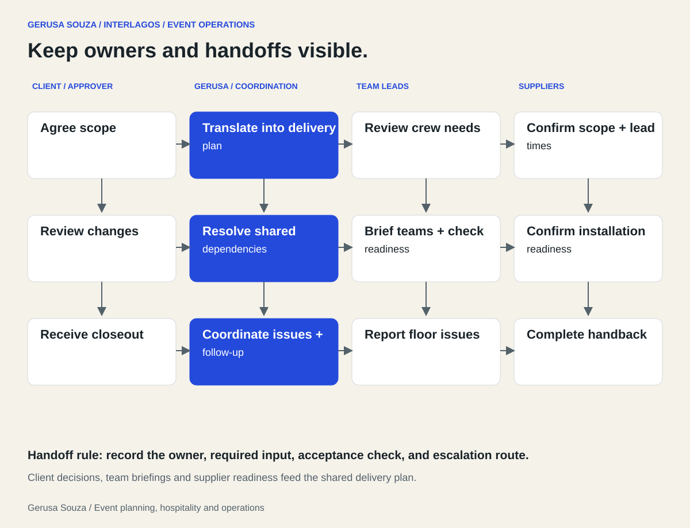

# Interlagos: VIP Hospitality & Event Operations

Gerusa Souza · São Paulo, Brazil

A visual walkthrough of my work in VIP hospitality, supplier coordination, staffing and client management around the Formula 1 race weekend, alongside Porsche Cup support.

## The assignment

Bring the client brief, suppliers, workforce and guest experience together through planning and on-site delivery.

My responsibilities covered account management, hospitality operations, supplier coordination, cost management and client communication.

## 01 / Event overview

My work connected hospitality environments, staffing, suppliers and client requirements within the race-weekend schedule.

## 02 / Delivery roadmap

The roadmap connects each phase with its deliverables and decision points.

## 03 / Team workflow

Clear ownership keeps client decisions, supplier activity and floor operations connected.

## Delivery framework

The following documents present my planning and coordination approach. Working templates accompany the case study for readers exploring the operational detail.

| Document | Purpose |
|---|---|
| [Brief and responsibilities](deliverables/01-brief-and-responsibilities.md) | Define scope, workstreams and handoffs |
| [Readiness checklist](deliverables/02-readiness-checklist.csv) | Connect checks, owners and acceptance criteria |
| [Run-of-show template](deliverables/03-run-of-show.csv) | Structure dependencies and operational handoffs |
| [Issue and decision log template](deliverables/04-issue-decision-log.csv) | Record ownership, decisions and follow-through |
| [Closeout framework](deliverables/05-closeout.md) | Organise reconciliation, review and client follow-up |

## Skills in practice

| Capability | Application |
|---|---|
| Project planning | Translate the brief into phases, responsibilities and delivery priorities |
| Account management | Maintain client communication across preparation and delivery |
| Team leadership | Coordinate staff responsibilities and operational handoffs |
| Hospitality operations | Connect guest-facing service with the work behind the scenes |
| Supplier and cost coordination | Align resources, installation requirements and spending |
| Business development | Build relationships extending into repeated work and Porsche Cup support |

## Client relationship

The Formula 1 VIP hospitality work developed into repeat assignments and a related Porsche Cup engagement.

## Explore the presentation

[index.html](index.html) contains the visual case-study page. Download the project folder to open the page locally, or view through the portfolio website after deployment.
